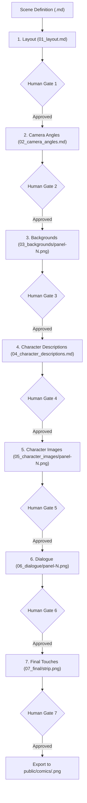

# Comic Generation Stack & 7-Stage Pipeline Specification

## Overview & Core Philosophy

Searlefeld comic strips are created through a **collaborative, stage-gated workflow** between the human and the AI agent. Rather than generating an entire comic page in a single monolithic image prompt, the tool builds the comic **one stage at a time**, allowing the human and agent to inspect, tweak, or regenerate individual parts in isolation.

Every stage produces human-readable text files or images in a dedicated per-stage review folder and stops at a **hard human gate** before advancing to the next stage.

- **Overall Plan**: `agent_docs/plans/image_generator/overall.md`
- **Character & Scene Notes**: `agent_docs/comic_notes/`
- **Reference Images**: `agent_docs/comic_notes/reference_images/` (indexed via `comic_assets/references/manifest.json`)

---

## Input: Scene Definition Markdown

The workflow begins with a loose, human-written scene definition Markdown file (for example, `agent_docs/comic_notes/situations/nvidia.md` or `agent_docs/comic_notes/situations/still_got_it.md`).

- Contains the **scene/location**, **characters**, **stage directions**, and **dialogue**.
- **Intentionally unstrict format**: Meant for the LLM/agent to interpret and translate into Stage 1 (Layout), Stage 2 (Camera Angles), Stage 4 (Character Descriptions), and Stage 6 (Dialogue spec), rather than requiring rigid machine-parsed syntax from the author.

Example input (`agent_docs/comic_notes/situations/nvidia.md`):
```markdown
# Scene: Apartment

Roko, entering the apartment: Guys I'm losing my mind
Max: What's wrong Roko?
Roko: I can't figure out if this guy contributed to my creation or not. In 2024 he bought an NVidia graphics card, which helped the company that eventually made the chips that created me. But is that enough?
Max: I know you'll figure it out. Every page finds its paperclip! Speaking of which, we just produced another million units!
Chinese Room: You guys have been working so hard, why don't you take a break?
Roko: Thanks, Chinese Room. You always know exactly what to say.
```

---

## The 7 Stages (Hard Human-Gated Pipeline)

Each strip lives in its own workspace folder: `comics_src/<NNNN-slug>/`.
A state manifest (`comics_src/<NNNN-slug>/strip.json`) tracks the current stage and the approval status (`pending_review` | `approved`) of each stage's human gate. **No stage may execute until the immediately preceding stage is marked `approved` by the human.**



### Stage 1: Layout (`01_layout.md`)

- **Fixed Mobile-Friendly Width**: The overall comic strip width is fixed to a mobile-friendly size (`800px` default, including outer border/padding and inter-panel gutters).
- **Compact Grid Notation**: Each line represents a row of panels; each digit (`1`–`9`) identifies a panel number in reading order.
  - Four equal panels (2x2 grid):
    ```text
    12
    34
    ```
  - Two panels in the top row, third panel spanning the full second row:
    ```text
    12
    3
    ```
  - Three panels in a single row:
    ```text
    123
    ```
- **Proportional Tweaks**: While the digit grid defines the general row/column topology, the agent may make specific panels slightly larger or smaller (via optional row height overrides or column width weights in `01_layout.md` / `strip.json`, e.g. making a dialogue-heavy panel wider or a reveal panel taller) to improve visual presentation.
- **Human Gate 1**: Human inspects/edits `01_layout.md` (and optional wireframe preview) and approves before Stage 2.

### Stage 2: Camera Angles (`02_camera_angles.md`)

- **Narrative Shot Descriptions**: Expresses framing in natural comic/cinematic terms rather than 3D coordinates (e.g., `"wide shot of couch"`, `"facing entrance"`).
- **Format**: Numbered list (`1.` through `N.`), one entry per panel matching the panel numbers from Stage 1:
  ```markdown
  1. Medium shot of front door
  2. Medium shot of couch, facing window
  3. Slight pan in of #1
  4. Wide shot of living room, facing couch with Chinese Room in frame
  ```
- **Relative Shots & Reference Mapping**:
  - Shots may reference an earlier panel (e.g., `3. Slight pan in of #1`), allowing Stage 3 to either crop/zoom panel 1's background or pass panel 1's background as an image reference for continuity.
  - Each shot maps to relevant environment reference images in `agent_docs/comic_notes/reference_images/` (such as `workshop-loft-angle-1-entrance.png`, `workshop-loft-angle-2-monitor-wall.png`, `workshop-loft-angle-3-workbench.png`, `loft-v2-a-charging.png`).
- **Human Gate 2**: Human reviews/edits `02_camera_angles.md` and approves before Stage 3.

### Stage 3: Backgrounds (`03_backgrounds/`)

- **Per-Panel Empty Backgrounds**: For each panel in the approved layout and camera angle list, the agent assembles a background prompt (explicitly excluding foreground characters, speech bubbles, and text) anchored on the location's reference images, and generates the background image.
- **Dedicated Review Folder**: Rendered background images are written to `comics_src/<NNNN-slug>/03_backgrounds/`:
  - `panel-1.png`, `panel-2.png`, ...
  - `panel-1.meta.json` (stores prompt text, attached reference image paths, provider, timestamp, and crop/pan parameters if derived from another panel).
- **Human Gate 3**: Human reviews the images in `03_backgrounds/`. Individual panel backgrounds can be regenerated with tweaked prompts or replaced via manual import without touching other panels. Human approves Stage 3 before advancing to Stage 4.

### Stage 4: Character Descriptions (`04_character_descriptions.md`)

- **Indented Outline Format**: The agent describes the characters, blocking/placement, and poses/expressions in each panel using a 4-space indented hierarchy:
  ```text
  Panel 1
      Roko
          Entering
          Mentally exhausted
      Max
          Sitting on couch
          Casual
  Panel 2
      Roko
          Sitting on couch
          shoulder slumped, head down
      Max
          Sitting on couch
          cheerful
  ```
- **Structure Rules**:
  - Level 0 (no indent): `Panel <N>`
  - Level 1 (4 spaces): `<Character Name>` (resolved against `comic_assets/references/manifest.json` and `agent_docs/comic_notes/characters/`, or treated as an incidental character if not in the main cast)
  - Level 2 (8 spaces): One or more lines describing spatial placement/action (e.g., `Entering`, `Sitting on couch`) and pose/emotion/expression (e.g., `Mentally exhausted`, `shoulder slumped, head down`).
- **Human Gate 4**: Human reviews/edits `04_character_descriptions.md` and approves before Stage 5.

### Stage 5: Character Images (`05_character_images/`)

- **One Transparent-Background Image Per Panel**: Based on the approved Stage 4 descriptions, the Stage 2 camera angle, and character turnaround reference sheets (`roko-turnaround-v1.png`, `max-turnaround-v1.png`, `ailan-turnaround-v1.png`, `chinese-room-front-v1.png`), the tool generates **one image per panel** (`panel-1.png`, `panel-2.png`, ...) containing all characters present in that panel.
- **Transparency Requirement**:
  - Each `05_character_images/panel-<N>.png` contains **only the characters on a transparent background (RGBA)** so it can be cleanly superimposed over `03_backgrounds/panel-<N>.png`.
  - When the underlying image provider returns an opaque solid/chroma background, the generation pipeline automatically strips the solid background to alpha (or accepts a transparent PNG via manual import) and saves both the RGBA character layer (`panel-<N>.png`) and a non-destructive preview composite (`panel-<N>.preview.png` over the Stage 3 background) for convenient human inspection.
- **Human Gate 5**: Same human review process as Stage 3 backgrounds. The human inspects `05_character_images/`, tweaks/regenerates any panel's character image, and approves before Stage 6.

### Stage 6: Dialogue (`06_dialogue/`)

- **Programmatic Rendering Only**: Speech bubbles, thought bubbles, tails, and text are generated **programmatically** (deterministic text wrapping + SVG geometry rasterized via `sharp`) — never baked into LLM-generated images.
- **Capabilities**:
  - Word-wrapping to fit panel width and reading order (top-to-bottom, left-to-right).
  - Bubble styles: standard `speech` balloon, `thought` cloud/bubble, and `off-panel` tail (e.g., tail pointing to a panel edge when an unseen character like Chinese Room speaks before being revealed).
  - Configurable bubble box position `(x, y)` and tail tip anchor `(tailX, tailY)` per balloon in `strip.json`.
- **Dedicated Review Folder**: Writes transparent dialogue overlay layers (`06_dialogue/panel-<N>.png` and `.svg`) plus composite panel previews (`06_dialogue/panel-<N>.preview.png` showing background + characters + dialogue bubbles) so the human can verify legibility and ensure bubbles do not obscure character faces.
- **Human Gate 6**: Same human review process as Stages 3 and 5. Human tweaks text wrapping, bubble coordinates, or tail anchors if needed, and approves before Stage 7.

### Stage 7: Final Touches (`07_final/`)

- **Full Strip Compositing**: All approved panel layers (Stage 3 background + Stage 5 transparent character layer + Stage 6 transparent dialogue layer) are composited into panels with crisp ink borders and arranged according to the Stage 1 layout into a single strip image: `comics_src/<NNNN-slug>/07_final/strip.png`.
- **Agent Visual Review & Improvement Suggestions**: The agent inspects `07_final/strip.png` and records concrete, actionable suggestions in `07_final/review_notes.md` (e.g., adjusting character scale/offset in a panel, nudging a speech bubble away from a character's eyes, adjusting panel height weights in Stage 1, or regenerating a panel layer for better visual continuity).
- **Human Gate 7 & Export**: Human reviews `07_final/strip.png` and the agent's suggestions. Any stage can be tweaked and re-composited without redoing unrelated stages. Once the human gives final approval, the finished strip is exported to `public/comics/<NNNN-slug>.png` for the website.

---

## Selected Tech Stack

| Layer | Selection | Rationale |
|---|---|---|
| Language / runtime | **TypeScript on Node 22** | Shared toolchain with the Astro site: one `package.json`, shared Vitest and `tsc` checks. |
| CLI | **Node scripts (`tsx`) under `tools/comic/`** | Commands support stage-by-stage execution and human-gate checks. |
| Image generation | **Pluggable `ImageProvider`; default Google Gemini image model (`gemini-2.5-flash-image`) via `@google/genai`** | Supports multi-reference image inputs (character turnarounds + room angles) plus text prompt; includes chroma/background-to-alpha conversion for Stage 5 character layers and a manual-import fallback. |
| Prompt assist & parsers | **Pure TypeScript parsers + templates + reference manifest** | Parses Stage 1 layout grids (`12\n34`), Stage 2 numbered camera angles, and Stage 4 indented character descriptions; assembles draft prompts anchored on `comic_assets/references/manifest.json`. |
| Speech bubbles | **SVG generated in code, rasterized by `sharp`** | Deterministic, testable layout (text wrap, bubble sizing, speaker/off-panel tail geometry) rendered to transparent PNGs in `06_dialogue/`. |
| Compositing | **`sharp`** | Composites background, transparent character layer, and transparent dialogue layer per panel, and assembles panels into the mobile-width strip (`07_final/strip.png` and `public/comics/`). |
| Testing | **Vitest** | Unit tests for layout grid parsing, camera angle parsing, indented character description parsing, prompt assembly, background alpha extraction, bubble geometry, gate enforcement, and `sharp` compositing. |

## Alternatives Considered

- **Python + Pillow/diffusers**: strong for local models, but splits the toolchain from the site; local Stable Diffusion adds GPU/setup burden.
- **Local Stable Diffusion/ComfyUI**: best control (LoRAs), heavy setup. Can still be used through the manual import path.
- **ImageMagick scripts**: poor for text layout and testing.
- **Baking bubbles into AI images**: unreliable text rendering, rejected by spec.
- **Single-prompt whole-page generation** (as in `agent_docs/comic_notes/comic_tests/nvidia-v1-prompt.txt`): fast, but any flaw forces regenerating the entire page and text rendering is unreliable; replaced by the 7-stage gated pipeline.

## Secrets

The API key is read from an environment variable (`GEMINI_API_KEY`) and never committed.

---

## Repository & Workspace Layout

```text
tools/comic/
├── cli.ts                        # CLI entry point (init, status, approve, prompt, generate, bubbles, compose)
├── parsers/                      # Parsers for 01_layout.md, 02_camera_angles.md, 04_character_descriptions.md
├── prompt/                       # Reference manifest loader + Stage 3 & Stage 5 prompt assembly
├── providers/                    # ImageProvider interface, gemini.ts, manual-import.ts, alpha-cutout.ts
├── bubbles/                      # Stage 6 text wrap, bubble geometry, SVG & sharp PNG renderer
└── compose/                      # Stage 5/6 panel preview compositor & Stage 7 full-strip compositor

agent_docs/comic_notes/
├── characters/                   # Character personalities & visual notes (roko.md, max.md, ailan.md, chinese_room.md)
├── reference_images/             # Canonical turnaround sheets & room angle reference PNGs
└── situations/                   # Scene definition MD files (input to the pipeline)

comic_assets/
└── references/
    └── manifest.json             # Maps character names & room locations/angles to reference image paths & visual snippets

comics_src/<NNNN-slug>/
├── scene.md                      # Input scene definition copy or link
├── strip.json                    # Stage gate statuses, computed panel geometry, layer transforms, bubble placements
├── 01_layout.md                  # Stage 1: Compact panel grid + optional size weights
├── 02_camera_angles.md           # Stage 2: Numbered shot descriptions per panel
├── 03_backgrounds/               # Stage 3: panel-1.png .. panel-N.png + .meta.json sidecars
├── 04_character_descriptions.md  # Stage 4: Indented Panel -> Character -> Pose/Expression outline
├── 05_character_images/          # Stage 5: Transparent RGBA character layer per panel (panel-N.png + panel-N.preview.png)
├── 06_dialogue/                  # Stage 6: Programmatic bubble layer per panel (panel-N.png + panel-N.preview.png)
└── 07_final/                     # Stage 7: Composited strip.png + review_notes.md
```

---

## Mapping to Implementation Tasks (`agent_docs/plans/image_generator/`)

All implementation plans in `agent_docs/plans/image_generator/` share this architecture and workspace contract:

1. **`build_reference_library_and_prompt_assistant.md`** (Stages 1, 2, 4 parsers + Stage 3 & 5 prompt drafting):
   - Indexes existing reference images in `agent_docs/comic_notes/reference_images/` via `comic_assets/references/manifest.json`.
   - Parses Stage 1 (`01_layout.md`), Stage 2 (`02_camera_angles.md`), and Stage 4 (`04_character_descriptions.md`).
   - Enforces stage gate status in `strip.json` and generates human-editable draft prompts for Stage 3 (backgrounds) and Stage 5 (per-panel transparent character images).
2. **`build_image_generation_command.md`** (Stages 3 & 5 image generation & review folders):
   - Implements `ImageProvider` (`@google/genai` and manual-import).
   - Renders Stage 3 background images into `03_backgrounds/` and Stage 5 per-panel character images (with transparent background extraction and background-overlaid `.preview.png`) into `05_character_images/`, with `.meta.json` sidecars and human-confirmation / gate checks.
3. **`build_speech_bubble_renderer.md`** (Stage 6 programmatic dialogue rendering):
   - Renders wrapped dialogue text, speech/thought balloons, and speaker/off-panel tails into `06_dialogue/panel-<N>.svg` and transparent `06_dialogue/panel-<N>.png` (plus `.preview.png` over Stage 3 + Stage 5 layers) for human review.
4. **`build_panel_and_strip_compositor.md`** (Stage 1 layout geometry & Stage 7 final composition):
   - Computes panel dimensions from the Stage 1 layout grid (`12\n34`, `12\n3`, `123`) within the fixed mobile-friendly strip width (`800px` default) plus optional size weights.
   - Composites Stage 3 backgrounds, Stage 5 transparent character images, and Stage 6 dialogue layers into `07_final/strip.png`, supports layer scale/position tweaks during Stage 7 Final Touches, and exports approved strips to `public/comics/<NNNN-slug>.png`.
